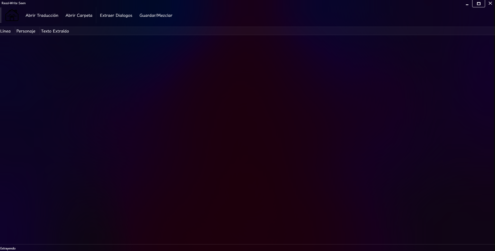

# SeenExtractor

Lector y editor de los Scripts Seen###.txt de Clannad.

> Este proyecto es una aplicación ligera desarrollada en ratos libres con el propósito de facilitar la localización de la novela visual *CLANNAD* (Edición de Steam con soporte para Dangopedia). 
> 
> **Nota importante:** Para su correcto funcionamiento, se requiere contar con los archivos del juego previamente desempaquetados.

> ⚠️ **Nota sobre la Interfaz Gráfica:**
> La interfaz de esta aplicación es puramente funcional y minimalista (por no decir algo rústica), ya que el foco principal estuvo en la lógica y la utilidad para el proceso de localización más que en el diseño visual. Aunque cuenta con soporte para temas, **se recomienda encarecidamente utilizar los atajos de teclado** detallados a continuación para una experiencia mucho más rápida y fluida.
> 
> *Así luce actualmente la interfaz:*
> 

Los archivos tendran una aparencia similar a la siguiente:

# Operaciones de uso

* Para cargar los archivos, podrás realizarlo con la combinación de teclas **CTRL + O**.
* Para extraer los diálogos una vez abierto el script, lo podrás hacer con la combinación **CTRL + E**.
* Para la lectura de archivos con los diálogos localizados, podrás hacerlo con la combinación **CTRL + N**. Además, deberán tener un formato específico mostrado a continuación:
  - 
    *(Este formato será el obtenido al extraer los diálogos de los scripts).*

### 📝 Consideraciones sobre el formato de texto:
* **Límite de caracteres:** Al final de cada línea estará presente el indicador de longitud en el formato `(Número de caracteres usados / Límite de caracteres)`.
* **Codificación y compatibilidad de idiomas:** Los diálogos serán leídos en codificación **ANSI**. Por ejemplo, si deseas utilizar japonés para el nombre de un personaje como *Kotomi* (**ことみ**), la entrada de diálogo en ANSI se visualizará como **`‚±‚Æ‚Ý`** (esto dependerá también de si la fuente utilizada en el juego soporta el idioma japonés).
  
* Podrás hacer lectura o extracción masiva de los scripts mediante las teclas **CTRL + M**.
* Para buscar texto dentro de los scripts, utiliza la combinación **CTRL + F**.
* Para buscar y reemplazar texto, utiliza la combinación **CTRL + H**.
* Para cambiar el tema de la aplicación, podrás hacerlo utilizando la combinación **CTRL + SHIFT + T**.

# Sustucion de diálogos - Cosas a tener en cuenta

Este programa no requiere la modificación del ejecutable original de la VN por lo que las localizaciones seran aceptadas automaticamente por la VN original.
Sin embargo esto lleva a conflictos y situaciones que no se pueden resolver siendo las siguientes:

* La localización debe respetar la longitud en bytes del texto original.
  - Esto provocara que algunos diálogos no puedan entrar su localización en el espacio original obligando a recortar frases, simplificar oraciones, ser mas fiel al Japones.
* Los archivos guardados (Save Data) anteriores no seran compatibles con los nuevos que genere la VN con el dialogo localizado y tampoco serán jugables (Si los cargara, pero la VN quedara pasmada, lo que lleva a que los Save Data de un idioma solo sean jugables con ese idioma en los dialogos).
* El soporte de localización está actualmente limitado al Español.
  - La sustitución de caracteres especiales (Ñ, ñ, etc) la tengo sujeta a la fuente **Klee One** modificada que también se encontrara en la carpeta **docs**.

# Contenido de apoyo

Para ayuda en la identificación de archivos. Dejare un listado por cada personaje, menú, etc. De esta manera podrán enfocarse en la localización de una Ruta en especifico o textos de interfaz de manera mas rapida. Estos estaran disponibles en la carpeta **docs**

## 🤝 Aportes y Agradecimientos

Este proyecto nació como una iniciativa independiente en mis tiempos libres. Si alguien desea apoyar con la adición de soporte para nuevos idiomas o mejoras, **es completamente bienvenido**.

En la carpeta **docs** estará disponible la tabla del **CodePage 932** (utilizado por el motor de la VN) para que puedan apoyarse en la modificación orientada a la sustitución de caracteres a la fuente de su elección.

### ¿Cómo puedes colaborar?
* **Aportes técnicos:** Si quieres contribuir con código, correcciones o adaptaciones, puedes abrir un *Pull Request* o un *Issue* en el repositorio.
* **Archivos y recursos de apoyo:** Cualquier material útil para el desarrollo o localización puede integrarse en la estructura del proyecto.

¡Gracias por tu interés y por apoyar el proyecto!
